## About me

BCA student specialising in Artificial Intelligence and Machine Learning, based in Puttur, Karnataka. I build small, practical ML projects and I'm moving into AI agents.

## What I've built

| Project | What it does |
| --- | --- |
| [MiraiDesk-AI](https://github.com/SukeshaPS701/Customer-Churn-Analysis) | Analyses which customers are likely to leave |
| [Spam-Mail-Prediction](https://github.com/SukeshaPS701/Spam-Mail-Prediction) | Classifies emails as spam or not spam |
| [Music-Recommendation-System-project-](https://github.com/SukeshaPS701/Music-Recommendation-System-project-) | Recommends music based on listening data |
| [Face-Detection](https://github.com/SukeshaPS701/Face-Detection) | Detects faces in images |
| [AI-Agent](https://github.com/SukeshaPS701/AI-Agent) | Python AI agent project |

## Stack

## Connect

